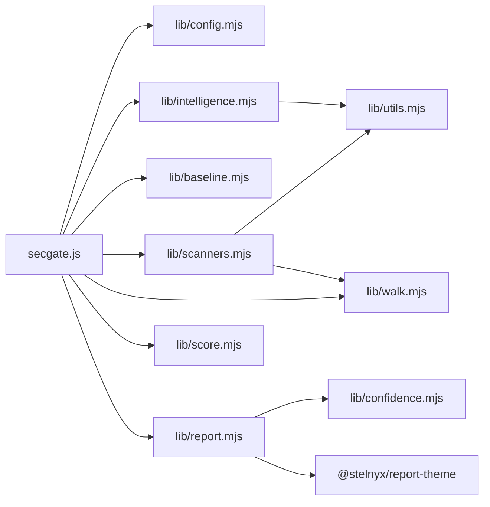
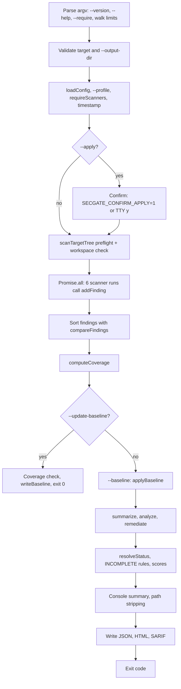
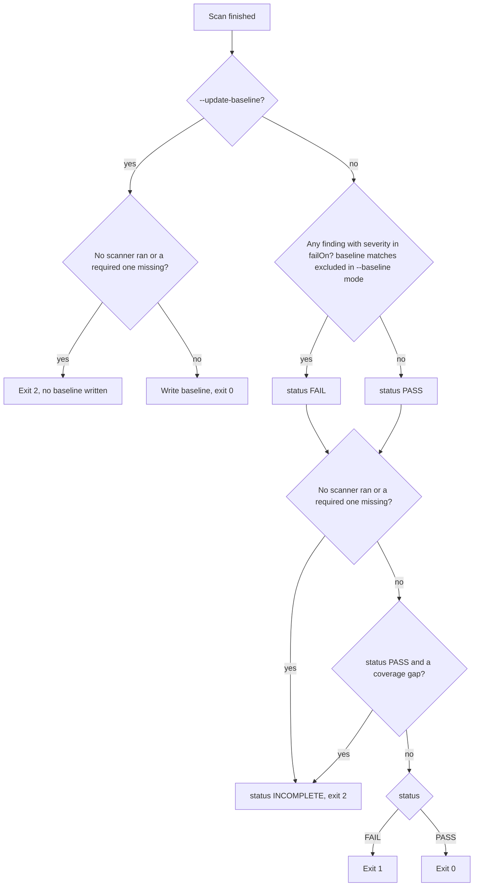
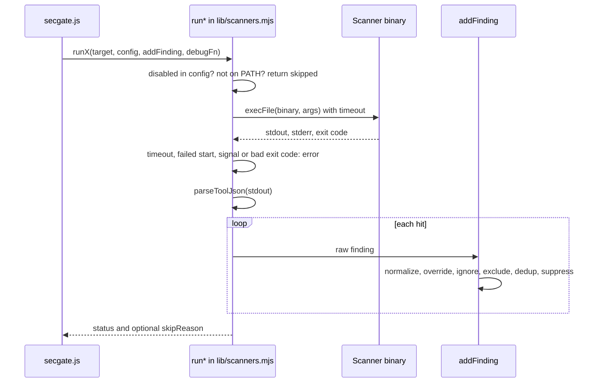

# SecGate architecture

This document describes how the `@stelnyx/secgate` CLI is built, as of `v0.3.3`.
Every number, threshold and path below comes from the source. When the code
and this file disagree, the code wins and this file has a bug.

Related: [threat model](docs/threat-model.md), [coverage matrix](docs/coverage.md),
[aggregation contract](docs/aggregation.md), [tuning](docs/tuning.md),
[ADRs](docs/adr/).

## System at a glance

SecGate is a Node.js (`>=18`, ES modules) CLI that:

1. walks the target directory once with hard limits (preflight),
2. runs up to five external scanners in parallel (Semgrep, Gitleaks, npm audit,
   osv-scanner, Trivy; Trivy runs a filesystem scan and a base-image scan),
3. normalizes every hit into one finding shape,
4. computes a gate status, a 0-100 Security Score and a risk score,
5. writes a JSON report, an HTML report and, on request, a SARIF 2.1.0 file,
6. exits `0` (PASS), `1` (FAIL) or `2` (INCOMPLETE or usage error).

SecGate has no analysis engine of its own. Every finding comes from a wrapped
scanner, except one policy finding (`no-lockfile`) that SecGate emits itself.
The only runtime dependency is `@stelnyx/report-theme` (HTML shell and CSS).

## Module map

| Path | Role |
|---|---|
| `secgate.js` | Entry point and orchestrator: argument parsing, validation, preflight, parallel scanner run, coverage, baseline, status, console output, report writing, exit code. |
| `lib/config.mjs` | Loads `.secgate.config.json` from the target, applies defaults (`CONFIG_DEFAULTS`), confines `baselineFile` and `customSemgrepRules` to the target, implements `--ignore-target-policy`. |
| `lib/walk.mjs` | Bounded preflight walk (`scanTargetTree`): file, depth, size and time limits, excluded directories, symlink skipping, Dockerfile discovery, workspace detection data. |
| `lib/scanners.mjs` | One `run*` function per scanner, the finding processor (`makeFindingProcessor`), inline suppression, severity mapping for Semgrep and OSV, and the total order `compareFindings`. |
| `lib/utils.mjs` | Process execution with timeouts (`runToolAsync`, `runTool`), `PATH` lookup (`toolExists`), `normalizeSeverity`, glob matching (`matchPattern`), `parseToolJson`. |
| `lib/baseline.mjs` | Read, write and apply the baseline file. |
| `lib/intelligence.mjs` | `analyze` (risk score, attack surface, reasoning, recommendations) and `remediate` (fix plan, `--apply` execution of `npm audit fix`). |
| `lib/score.mjs` | Security Score and per-scanner scores (`SCORE_VERSION = "v1"`). |
| `lib/confidence.mjs` | `curated` / `strict` profile: classifies findings as actionable or informational for the HTML report only. |
| `lib/report.mjs` | Scanner lists and labels, coverage, summary, status, path stripping, HTML renderer, SARIF serializer. |
| `scripts/check-deps.mjs` | Release guard: fails on `file:`, `link:` or `workspace:` dependencies. |
| `scripts/verify-release.sh` | Verifies release assets (checksums, cosign, SLSA provenance). |
| `.github/actions/secgate/action.yml` | Composite GitHub Action that runs the CLI and applies its own `fail-on` filter. |

### Module dependencies

Edges are the real `import` statements. `config`, `baseline`, `score`,
`confidence`, `utils` and `walk` import only Node built-ins.



## Run pipeline

`secgate.js` is a single top-level script. The order below is the order of the
code.



Notes on the order:

- Any validation failure before the scan exits `2` without writing a report.
- `remediate` runs before reports are written, so with `--apply` the
  `npm audit fix` calls happen even if the run later exits `2`.
- Path stripping (`--strip-paths`, on when `CI=true`) runs after the console
  summary and before the files are written.
- The confidence profile is applied only inside `renderHtml`. It does not
  change the JSON, the SARIF, the score or the exit code.

## Gate and exit code



Definitions used by the gate (all in `secgate.js` and `lib/report.mjs`):

- **Ran**: a scanner status of `ran` or `clean` (`computeCoverage`). Trivy
  counts as ran only if its fs scan ran and its image scan is not `error`.
- **Coverage gap**: a scanner that did not run, unless its skip reason is
  `disabled in config`, `no package.json in target` or
  `no package sources found` (`NOT_A_GAP`). So `not installed`, a timeout, an
  error, Gitleaks outside a git repository, and npm audit without a lockfile
  are gaps.
- A gap turns PASS into INCOMPLETE. It does not turn FAIL into INCOMPLETE.
  A missing required scanner (`--require` or `requireScanners`) gives
  INCOMPLETE and exit `2` even with blocking findings.
- Exit `2` also covers: invalid target, unwritable output directory, a bad
  `--profile`, `--require` or walk-limit value, a non-array or unknown
  `requireScanners`, an invalid `SECGATE_TIMESTAMP` or `SOURCE_DATE_EPOCH`,
  an unconfirmed `--apply`, a walk limit hit, a workspace target without
  `--allow-workspace`, and a failed report write.

## Scanner invocation and normalization

All processes start with `execFile` and an argument array (no shell), a
`maxBuffer` of 64 MiB and a default timeout of 180 s
(`DEFAULT_TOOL_TIMEOUT_MS`). A scanner is looked up on `PATH` by `toolExists`
before it runs.



| Scanner | Command | Accepted exit codes | Signature | Type | Severity source |
|---|---|---|---|---|---|
| Semgrep | `semgrep [--config=<customSemgrepRules>] --config=auto --json <target>` | 0, 1 | `check_id` | `code` | `ERROR`→HIGH, `WARNING`→MEDIUM, `INFO`/`NOTE`→LOW, other→MEDIUM; secret-like rules (category `security` plus a secret keyword, or CWE-798/259/321/522)→CRITICAL |
| Gitleaks | `gitleaks detect --source <target> --report-format json --report-path <tmp> --redact` (env `LC_ALL=C`) | 0, 1 | `RuleID` | `secret` | always CRITICAL |
| npm audit | `npm audit --json` (cwd = target) | not checked; JSON `error` means error | package name | `dependency` | npm `severity` |
| osv-scanner | `osv-scanner --format json -r <target>` | 0, 1, 128 (128 = no package sources, skipped) | `<ecosystem>:<name>@<id>` | `dependency` | numeric CVSS in `severity[].score`, then `database_specific.severity`, then text, else UNKNOWN |
| Trivy fs | `trivy fs --quiet --format json --exit-code 0 --scanners misconfig,license --skip-dirs **/node_modules <target>` | 0 | `<ID>:<Target>` or `<license>:<pkg>` | `iac` or `license` | Trivy `Severity` |
| Trivy image | `trivy image --format json --quiet --exit-code 0 <ref>` per `FROM` image, 120 s each | 0 | `trivy-image:<ref>:<VulnerabilityID>` | `dependency`, `scanMode: "image"` | Trivy `Severity` |

Details that matter:

- Gitleaks `detect` scans git history only. Outside a git repository it is
  skipped with reason `not a git repository (...)`, which is a coverage gap.
- npm audit runs only when `package.json` exists in the target root. An
  `ENOLOCK` error adds the `no-lockfile` finding (tool `secgate`, type
  `policy`, MEDIUM) and marks npm audit skipped, which is a gap.
- Trivy image scanning reads Dockerfiles found by the preflight walk
  (`Dockerfile` or `*.Dockerfile`, at most `--max-file-size`), skips `scratch`
  and earlier build-stage names, and honors `excludePaths`. Image findings
  carry tool `trivy`, so the SARIF `trivyImage` run has no results.
- `normalizeSeverity` (`lib/utils.mjs`) maps `MODERATE` and `WARNING` to
  MEDIUM, `ERROR` to HIGH, `INFO`, `NOTE`, `INFORMATIONAL` and `NEGLIGIBLE` to
  LOW, and anything unknown to UNKNOWN.

### Finding processor

`makeFindingProcessor` (`lib/scanners.mjs`) applies these steps in order:

1. normalize severity;
2. first matching `severityOverrides` entry wins (glob `*` on `signature`);
3. drop if `signature` matches `ignore`;
4. drop if `file` matches `excludePaths` (raw value or target-relative);
5. drop duplicates keyed by `tool|signature|file|image|line`;
6. drop and count if the flagged line or the line above has
   `secgate:ignore <rule>` after `#`, `//` or `/*` (only when the finding has
   a file inside the target and a line);
7. set `fixableBy` (`auto` from npm audit, else `manual`) and `fixable`.

After all scanners finish, `compareFindings` sorts by tool, file, line,
column, signature, image, then the JSON of the whole finding.

## Scoring and confidence

| Metric | Formula | Source |
|---|---|---|
| Security Score | `max(0, 100 − Σ penalty)`, penalty CRITICAL 25, HIGH 10, MEDIUM 3, LOW 1, UNKNOWN 0 | `lib/score.mjs` |
| Per-scanner score | same formula over that scanner's findings; `null` if it did not run | `computeToolScores` |
| Risk score | `Σ weight` over findings not matched by the baseline, weight CRITICAL 10, HIGH 6, MEDIUM 3, LOW 1 | `analyze` in `lib/intelligence.mjs` |
| Remediation confidence | `max(0, 100 − 30 × CRITICAL findings not matched by the baseline)`, then capped at `round(100 × ran / 5)` | `remediate` and `secgate.js` |

The Security Score is `null` when no scanner ran. It is computed over all
reported findings, including baseline matches. Console colors: green at
`>= 90`, amber at `>= 70`, red below. The HTML band is STRONG `>= 85`,
GOOD `>= 70`, MIXED `>= 50`, WEAK below.

The `curated` profile (default) marks a finding informational when, in this
order: severity is UNKNOWN; type is `license`; it is a Trivy image finding at
LOW or MEDIUM; its signature has a `CVE-YYYY-` year older than the current year
minus 5 and severity is not CRITICAL; or the signature matches
`html.security.audit.missing-integrity*` or
`javascript.lang.security.audit.path-traversal.path-join-resolve-traversal*`.
`strict` marks everything actionable. Informational findings still count for
`failOn`, the score and the summary.

## Baseline

- `--update-baseline` writes `baselineFile` (default `.secgate-baseline.json`,
  must resolve inside the target) as
  `{ generatedAt, findings: [{ signature, severity, file, line }] }`, then
  exits `0`. It refuses (exit `2`) when no scanner ran or a required scanner
  did not.
- `--baseline` loads the file and marks each finding `baseline: true` when
  `signature|file|line` matches. Matched findings stay in the report, are
  excluded from the gate, the risk score and the fix plan, and
  `baselineDiff = { netNew, baselineMatchedCount }` is added. A missing or
  invalid file means every finding is net-new.

## Configuration

`.secgate.config.json` is read from the target directory, so in pull-request
CI it is attacker-controlled. Keys and defaults are in `CONFIG_DEFAULTS`
(`lib/config.mjs`) and the [JSON Schema](docs/config.schema.json): `failOn`,
`scanners`, `severityOverrides`, `ignore`, `excludePaths`, `baselineFile`,
`customSemgrepRules`, `requireScanners`, `profile`. Invalid JSON prints an
error and uses the defaults. `--ignore-target-policy` replaces `failOn`,
`ignore`, `excludePaths` and `severityOverrides` with the defaults; it does not
touch `scanners`, `requireScanners`, inline suppressions or the baseline file.
Precedence: CLI flag, then config file, then defaults.

## Adding a scanner

The steps below follow the existing scanners. See
[ADR-0001](docs/adr/0001-scanner-stack.md) and the criteria in
[coverage.md](docs/coverage.md#adding-a-scanner) before starting.

1. `lib/scanners.mjs`: add `export async function runX(target, config, addFinding, debugFn)`.
   Return `{ status: "skipped", skipReason: "disabled in config" }` when
   `config.scanners.x === false` and `skipReason: "not installed"` when
   `toolExists` fails. Call `runToolAsync` with an argument array, map
   `timedOut` through `timeoutResult`, reject bad exits with
   `processFailure(label, result, okCodes)`, parse with `parseToolJson`, and
   call `addFinding({ tool, type, severity, signature, message, file, line })`
   per hit. Return `ran`, `clean` or `error`.
2. `lib/report.mjs`: add the key to `TOOLS`, `SCANNERS`, `SCANNER_LABEL`,
   `INSTALL_HINTS`, `TOOL_INFO` (SARIF), and `TOOL_ORDER` / `TOOL_LABEL` in
   `renderHtml`; add an alias to `SCANNER_ALIASES` if needed.
3. `lib/config.mjs` and `docs/config.schema.json`: add the key to
   `scanners` and to the `requireScanners` enum.
4. `secgate.js`: add the call to the `Promise.all` block, an `applyResult`
   line, the help text, and a `NOT_A_GAP` reason if "nothing to scan" is a
   valid outcome.
5. `lib/intelligence.mjs`: add a `patch()` branch for fix guidance.
6. Tests: a stub binary and fixture in the style of `test/schema.mjs` and
   `test/fixtures/schema/`, plus updates to hard-coded counts
   (`coverage.total` in `test/smoke.mjs`, SARIF run count in
   `test/sarif.mjs`).
7. Docs: README scanner table, `docs/coverage.md`, and this file.

## Determinism and network posture

- Findings are sorted with a total order, so scanner finish order and Trivy
  result order do not change the report (`test/determinism.mjs`).
- `SECGATE_TIMESTAMP` (ISO 8601) or `SOURCE_DATE_EPOCH` (seconds) pins the
  report and audit-log timestamps; an invalid value exits `2`.
- Not pinned: scanner versions, rule sets and vulnerability databases; the
  baseline `generatedAt` (always wall-clock); the stale-CVE cutoff, which uses
  the current year; SARIF `driver.version`, read by running
  `<binary> --version` (5 s timeout).
- SecGate's own code opens no network connections and sends no telemetry.
  The scanners do: Semgrep fetches `--config=auto` rules from the Semgrep
  Registry, npm audit and osv-scanner query advisory APIs, Trivy downloads its
  databases and pulls images.
- The HTML report links Google Fonts (`fonts.googleapis.com`,
  `fonts.gstatic.com`) through `@stelnyx/report-theme`, so a browser opening
  it makes those requests. Without network the report falls back to system
  fonts.

## Testing layout

`npm test` runs 16 plain Node scripts in sequence (no test framework);
`npm run test:coverage` wraps it with `c8`. Most CLI tests put stub scanner
binaries first on `PATH` and run `secgate.js` against a temp directory.

| File | Covers |
|---|---|
| `test/engine.mjs` | `lib/` modules imported directly, no subprocess |
| `test/score.mjs`, `test/confidence.mjs`, `test/walk.mjs` | score, profiles, preflight walk |
| `test/schema.mjs` | each scanner parser against `test/fixtures/schema/*.json` |
| `test/config.mjs`, `test/baseline.mjs`, `test/suppression.mjs` | config loading, baseline, inline suppression |
| `test/sarif.mjs`, `test/trivy-image.mjs`, `test/no-lockfile.mjs` | SARIF shape, image mode, `no-lockfile` finding |
| `test/timeout.mjs` | process timeout handling |
| `test/determinism.mjs`, `test/golden-secgate.mjs` | ordering, byte-identical reports, locked score `22` |
| `test/smoke.mjs` | end-to-end runs (needs `SECGATE_INTERNAL_TEST=1`; real scanners when installed) |
| `test/action-exit.mjs` | the composite action's step script against a stub CLI |

`SECGATE_INTERNAL_TEST=1` makes Trivy skip `**/test/fixtures` so the repo's
own fixtures do not pollute self-scans.

## Key data types

```text
Finding {
  tool: "semgrep" | "gitleaks" | "npm" | "osv" | "trivy" | "secgate"
  type: "code" | "secret" | "dependency" | "iac" | "license" | "policy"
  severity: "CRITICAL" | "HIGH" | "MEDIUM" | "LOW" | "UNKNOWN"
  signature, message: string
  file: string | null; line, col, endLine: number | null
  fixable: boolean; fixableBy: "auto" | "manual" | null
  scanMode?: "image"; image?: string        // Trivy image findings
  baseline?: boolean                         // only in --baseline mode
}

ScannerResult { status: "ran" | "clean" | "skipped" | "error"; skipReason?: string }

Coverage { ran: string[]; skipped: string[]; total: 5 }
```

Report top-level keys (`secgate-v7-report.json`): `version`, `timestamp`,
`target`, `mode`, `status`, `securityScore`, `summary`, `findings`, `tools`,
`toolSkipReason`, `suppressions`, `intelligence`, `remediation`, `auditLog`,
`coverage`, `disabledByConfig`, `toolScores`, plus `baselineDiff` with
`--baseline` and `ignoredTargetPolicy` with `--ignore-target-policy`.
