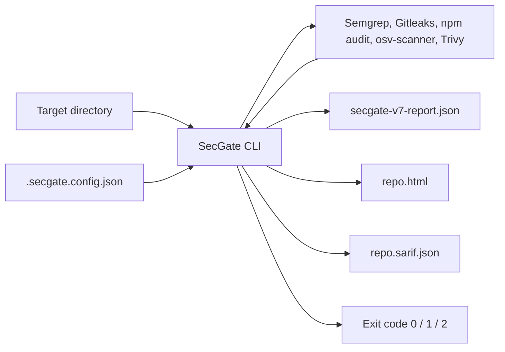

<!-- markdownlint-disable MD033 MD041 -->

<div align="center">

# SecGate

**A single-command security gate for CI/CD.**

Semgrep · Gitleaks · osv-scanner · Trivy · npm audit
One command. One report. One exit code.

<p>
  <a href="https://www.npmjs.com/package/@stelnyx/secgate"></a>
  <a href="LICENSE"></a>
  
  <a href="SECURITY.md"></a>
  <a href="https://github.com/Stelnyx/SecGate/actions/workflows/ci.yml"></a>
</p>

</div>

---

**SecGate** orchestrates five security scanners (**Semgrep, Gitleaks, osv-scanner, Trivy, and npm audit**) behind a single command. It normalizes their output into one report and fails the pipeline on CRITICAL or HIGH findings. No account and no telemetry. SecGate itself sends nothing over the network; the wrapped scanners fetch rules and advisories, and the HTML report makes no external requests (see [Network access](#network-access)).



How it works inside: [`ARCHITECTURE.md`](ARCHITECTURE.md).

**Positioning.** SecGate is a **triage accelerator**, not a defect oracle. The wrapped scanners are noisy on their own. SecGate's job is to surface what's actionable and demote the rest in the HTML report; see [What we demote (and why)](#what-we-demote-and-why).

**Status.** Early release (`v0.3.3`). From `v0.3.0` on, the tag-triggered release workflow publishes to npm with provenance and creates the signed GitHub Release; `v0.2.14` was published to npm without provenance and without a GitHub Release. Report vulnerabilities via [SECURITY.md](SECURITY.md).

**Accuracy contract.** SecGate's aggregation pipeline is deterministic — same inputs produce JSON-byte-identical findings, score, and gate status across every run. Findings are sorted by scanner, file, line, column and rule, so their order does not depend on which scanner finishes first or on the order a scanner lists its results in. Report files embed a timestamp, so they are byte-identical only when the inputs, the scanner versions and the timestamp are the same: set `SECGATE_TIMESTAMP` (ISO 8601, e.g. `2026-01-01T00:00:00Z`) or, if it is unset, `SOURCE_DATE_EPOCH` (Unix seconds). Both pin `timestamp` in the JSON report and the audit log; an unparsable value exits 2. Without them the timestamp is the wall-clock time. Scanner versions and rule databases are not pinned by SecGate. Two test suites lock the contract:

- `test/determinism.mjs` — JSON byte-equality across reruns, order-stable dedup, override + ignore applied identically, byte-identical JSON and HTML report files from two CLI runs with `SECGATE_TIMESTAMP` set, and the same report when the scanners finish in the opposite order and Trivy lists its results in the opposite order.
- `test/golden-secgate.mjs` — hand-crafted 11-finding fixture; expected counts, score (`22`), and gate status are inline so any change surfaces in code review.

Full pipeline spec lives in [`docs/aggregation.md`](docs/aggregation.md).

---

## Security Score

Every run now produces a **Security Score (0–100)** in addition to the binary PASS/FAIL gate. The score is deterministic: same findings → same score every time.

```
Security Score: 54 / 100   ███████████░░░░░░░░░  rule v1

  Semgrep      100 / 100   ████████████████████
  Gitleaks     100 / 100   ████████████████████
  npm audit    90 / 100   ██████████████████░░
  osv-scanner  64 / 100   █████████████░░░░░░░
  Trivy        100 / 100   ████████████████████
```

Real output of `node secgate.js test/fixtures/vulnerable-deps`, run from the repository root at commit `edea720` on 2026-11-15 with Semgrep 1.157.0, Gitleaks 8.30.1, osv-scanner 2.3.5, Trivy 0.70.0 and npm 11.19.1. The fixture pins `lodash` 4.17.15. Scores change when the scanners or their rule and vulnerability databases change.

Penalty per finding: CRITICAL −25 · HIGH −10 · MEDIUM −3 · LOW −1 · UNKNOWN 0 (scanner `INFO`/`NOTE` severities are normalized to LOW). Floor: 0. Color thresholds: green ≥ 90, amber ≥ 70, red < 70. The binary gate (exit 1 on CRITICAL/HIGH) is unchanged. `securityScore` and `toolScores` are also written to `secgate-v7-report.json` for CI dashboards and trend tracking.

---

## TL;DR

```bash
npx @stelnyx/secgate .
```

Runs every scanner it finds on your `PATH` against the current directory, writes a JSON report, a single-file HTML report, and (optionally) SARIF. Exit `0` on clean, `1` on CRITICAL/HIGH findings, `2` when the scan is incomplete (a scanner that applies did not run) or no scanner could run.

Without extra installs only **npm audit** runs (it ships with Node.js, and needs a `package.json` plus lockfile in the target). **Semgrep, Gitleaks, osv-scanner and Trivy** run only when they are installed and on `PATH` — see [Prerequisites](#prerequisites). Missing scanners are listed in a `WARNING: N of 5 scanners ran` line and shown as `n/a`, never as a pass.

---

## What it does today

SecGate wraps five existing open-source scanners, runs them against a directory, and produces:

- **One normalized JSON report** across every scanner
- **One single-file HTML report** (dark theme, inline CSS, no JavaScript, system fonts, no external requests)
- **One SARIF 2.1.0 file** ready for GitHub Code Scanning upload
- **One exit code** — `1` when CRITICAL or HIGH findings are present; blocks CI

SecGate does not ship its own analysis engine. Every finding originates from one of the five underlying tools. The value is **orchestration, normalization, and a single exit code.**

---

## Scanners

| Scanner       | Category                  | Notes                                                                 |
|---------------|---------------------------|-----------------------------------------------------------------------|
| **Semgrep**   | SAST (static code)        | `--config=auto` rules. Extend via `customSemgrepRules`. **Downloads its rules from the Semgrep Registry (network).** |
| **Gitleaks**  | Secrets & credentials     | Git history only: the committed changes of the repository that contains the target. Uncommitted files are not scanned, and a target outside a git repository is skipped. Secrets redacted. Local. |
| **npm audit** | Node dependencies (SCA)   | Runs when `package.json` present. **Queries the npm registry advisory API (network).** |
| **osv-scanner** | Polyglot SCA            | npm, PyPI, Go, Cargo, Maven, RubyGems, Packagist, NuGet, Pub. **Queries the OSV.dev API (network).** |
| **Trivy**     | IaC + License + Image     | Terraform, Kubernetes, Dockerfile, CloudFormation. Base-image CVEs. **Downloads its vuln DB; pulls image layers for image scans (network).** |

A missing scanner binary is skipped and listed in the report, but it is a coverage gap: a scan with no blocking findings then ends `INCOMPLETE` (exit `2`), not `PASS`. Set `"scanners": { "<name>": false }` to opt out of a scanner on purpose.

---

## Network access

SecGate's own code makes **no network calls**: no telemetry, no account, no phone-home, and the report is written to local files. One exception: four of the five wrapped scanners need the internet. The HTML report makes no external requests: it uses system fonts and loads no remote CSS, scripts or images.

| Scanner | Network use |
|---------|-------------|
| Semgrep | Downloads its rules from the Semgrep Registry (`--config=auto`), then runs them against your files. With registry rules, Semgrep sends its own usage metrics to Semgrep, Inc. by default ([Semgrep metrics](https://docs.semgrep.dev/metrics)); SecGate does not change that setting. |
| Gitleaks | None — scans your git history locally. |
| npm audit | Queries the npm registry's advisory API for your dependency tree. |
| osv-scanner | Queries the OSV.dev API for advisories matching your dependency manifests. |
| Trivy | Downloads/updates its vulnerability database; pulls image layers when scanning container images. |

So "no telemetry" is exact for SecGate's own code; Semgrep's metrics (above) are Semgrep's, and "fully air-gapped" is not — run SecGate offline and Semgrep, `npm audit`, `osv-scanner`, and `Trivy` will degrade or skip (which SecGate reports). On first run, `osv-scanner` and Trivy may download vulnerability databases; SecGate prints a one-line note before starting those scanners so the initial delay is not mistaken for a hang. There is no offline mode.

### Semgrep rules licensing

SecGate does not include or redistribute any Semgrep rules. When Semgrep is installed, SecGate runs your own `semgrep` binary on your machine with `--config=auto`, so Semgrep fetches the rules from the Semgrep Registry and you use them for your own internal business purposes under the [Semgrep Rules License v1.0](https://semgrep.dev/legal/rules-license), or under each third-party rule's own license. Semgrep is a trademark of Semgrep, Inc. SecGate is not affiliated with or endorsed by Semgrep, Inc.

---

## What we demote (and why)

The HTML report has **two confidence profiles**:

- **`curated` (default)** — actionable findings render inline. Known-noisy patterns get demoted to a collapsed **Informational** block. Demotion is presentation-only: demoted findings still count for `failOn`, the exit code, the score and the JSON/SARIF output.
- **`strict`** — every finding renders inline with no demotion. Use for compliance audits or when tuning the curated rule list.

Curated profile demotes:

| Pattern | Why demoted |
|---------|-------------|
| **License findings** (`type: license` from Trivy) | License posture is governance/legal, not security. Trivy's license severity still applies to `failOn`, so a license Trivy rates HIGH or CRITICAL fails the gate. |
| **Trivy base-image OS CVEs at LOW/MEDIUM** (`scanMode: image` or `signature: trivy-image:*`) | Rarely reachable from a Node/Python/Go app runtime (`apt-secure`, `libtinfo`, `perl-base`). CRITICAL/HIGH still surface inline. |
| **CVE IDs from a year before the current year minus 5**, severity != CRITICAL | Old and still unfixed upstream usually means bounded exploitability. |
| **`UNKNOWN` severity** findings | Scanner couldn't classify — surfaced for audit, not blocked. |
| **`html.security.audit.missing-integrity*`** | Fires on every `<script src>` without an SRI hash, including inline favicon SVGs. |
| **`javascript.lang.security.audit.path-traversal.path-join-resolve-traversal*`** | Common false positive in CLI tools that legitimately resolve user-supplied paths against a known root. |

In one internal dogfood scan of a 2,628-file codebase, the curated profile left 46 of 1,858 findings actionable. That run is not reproducible from this repository; your ratio depends on the codebase.

Findings are **never dropped** by curated demotion — they're re-classified for display ordering. Suppressed findings (inline `# secgate:ignore` comments) get their own collapsed block with per-rule counts for audit trail.

Toggle via `.secgate.config.json`:

```json
{ "profile": "curated" }   // or "strict"
```

Or via CLI:

```bash
secgate . --profile strict
```

---

## Positioning

SecGate is **not** a SOC platform, a compliance tool, or a vulnerability management system. It is a **CI gate** that aggregates scanner output and fails the build when something critical is found.

| Alternative        | When to pick it instead of SecGate                              |
|--------------------|-----------------------------------------------------------------|
| **Trivy standalone** | You only scan containers and don't need SAST or secrets.     |
| **Semgrep OSS**      | You only need SAST with custom rules.                        |
| **Snyk**             | You need a managed vuln DB, triage UX, Jira sync — and budget.|
| **Aikido**           | You want SaaS dashboards and are OK with a hosted account.   |

**SecGate's niche:** zero-config orchestration, local output only, MIT. If you need SaaS-grade triage or compliance workflow, buy Snyk or Aikido. Full matrix: [`docs/comparison.md`](docs/comparison.md).

---

## Prerequisites

Node.js `>=18`. npm audit needs nothing else. The other four scanners are separate installs and must be on `PATH`; any scanner that is not installed is skipped and reported as `n/a`. Use `--require <tools>` to make a missing scanner exit `2`.

```bash
# macOS
brew install semgrep gitleaks osv-scanner trivy

# Linux
pip install semgrep
# gitleaks:    https://github.com/gitleaks/gitleaks#installing
# osv-scanner: https://github.com/google/osv-scanner#installation
# trivy:       https://aquasecurity.github.io/trivy/latest/getting-started/installation/
```

---

## Install

### From npm (recommended)

```bash
npm install -g @stelnyx/secgate
```

### One-shot via npx (no install)

```bash
npx @stelnyx/secgate .
```

### From source

```bash
git clone https://github.com/Stelnyx/SecGate.git
cd SecGate
npm install
chmod +x secgate.js
sudo ln -sf "$(pwd)/secgate.js" /usr/local/bin/secgate
```

---

## Usage

```bash
# Scan current directory (dry-run, default)
secgate .

# Scan with auto-remediation (npm audit fix only — see warning below)
secgate . --apply

# Scan with debug output
secgate . --debug

# Scan specific path
secgate /path/to/project

# Write reports to a custom directory (default: the target)
secgate /path/to/project --output-dir /tmp/reports

# Strip absolute paths from the report (auto-on when CI=true)
secgate /path/to/project --strip-paths

# Show all findings inline (skip curated demotion)
secgate . --profile strict

# Raise bounded-walk limits for an unusually large single project
secgate . --max-files 50000 --max-depth 32

# Override workspace detection when you intentionally scan many sub-projects
secgate /path/to/workspace --allow-workspace

# Version / help
secgate --version
secgate --help
```

SecGate is designed for a single project target. Before launching external
scanners, it performs a bounded preflight walk that skips dependency, VCS,
vendor, and build-output directories (`node_modules`, `.git`, `dist`, `build`,
`coverage`, `vendor`, and common package-manager caches). Symlinks are skipped,
large files are not parsed, and the walk is capped by `--max-files`,
`--max-depth`, `--max-file-size`, and `--walk-timeout-ms`. If the target looks
like a workspace with multiple sub-projects and no root `package.json`, SecGate
exits with a clear message unless `--allow-workspace` is supplied.

**Exit codes**

| Code | Meaning                                            |
|:----:|----------------------------------------------------|
| `0`  | PASS — no CRITICAL or HIGH findings, and every scanner that applies ran |
| `1`  | FAIL — CRITICAL or HIGH findings present           |
| `2`  | Invalid target or CLI error (including an empty or unknown `--require` list, or a `requireScanners` value that is not an array or names an unknown scanner); `no scanners available` (none of the five scanners ran); a scanner listed in `--require` / `requireScanners` did not run; or INCOMPLETE (no blocking findings, but a scanner that applies did not run). `--update-baseline` exits `2` without writing a baseline when no scanner ran or a required one did not |

A scanner "applies" unless it is disabled in the config (`"scanners": { "<name>": false }`,
the explicit opt-out), or it has nothing to scan (npm audit with no
`package.json`, osv-scanner with no lockfile or manifest it can read). When a
scanner that applies is not installed, times out, exits with a failure code,
or fails in a way SecGate detects (unparsable output, a failed Trivy image
pull, Gitleaks outside a git repository, npm audit without a lockfile),
SecGate does not report PASS. Trivy counts as ran only when its filesystem scan
ran and its image scan did not fail; an image scan with no Dockerfile or no
`FROM` image to scan is not applicable and is not a gap.
Blocking findings from the
scanners that ran still give FAIL (exit `1`); otherwise the status is
`INCOMPLETE` (exit `2`). SecGate prints `WARNING: N of 5 scanners ran` on stderr
with an install hint per missing scanner, and reports the missing ones as `n/a`
(`null` in `toolScores`), never as `100 / 100`. `--require` /
`requireScanners` (also `--require=semgrep,...`) additionally exit `2` when a
listed scanner does not run, even if there are blocking findings.

**Untrusted pull requests.** `.secgate.config.json` is read from the scanned
repository, so a pull request can set `scanners.<name>: false` or its own
`requireScanners`, and a scan with nothing required still ends `PASS` (a
scanner disabled in config is not a gap). Only the `--require` flag (the
action's `require` input) set in your workflow is out of the PR's reach: a
required scanner that the config disables exits `2`. SecGate also prints
`NOTE: disabled by the scanned repo's .secgate.config.json: ...` after the
status line, and lists the scanners in `disabledByConfig` in the JSON report.
In a workflow that scans pull requests, use `with: require: semgrep,gitleaks`.
`--require` guarantees that the scanners ran, not that their findings block:
the config's `failOn`, `ignore`, `excludePaths` and `severityOverrides` can
still hide findings. Add `--ignore-target-policy` (the action's
`ignore-target-policy: "true"`) to ignore those four keys and use the built-in
defaults instead (`failOn: ["critical","high"]`, empty lists for the rest). The
console verdict prints `NOTE: --ignore-target-policy is set: ...` with the keys
the repo had set, and the JSON report (`ignoredTargetPolicy`) and each SARIF run
(`properties.ignoredTargetPolicy`) list them. The flag is off by default.
```yaml
- uses: Stelnyx/SecGate/.github/actions/secgate@main
  with:
    require: semgrep,gitleaks
    ignore-target-policy: "true"
```
Limits:
- The control holds only while pull requests cannot change the workflow file.
  A `pull_request` run uses the workflow file from the pull request's merge
  commit, so a pull request can edit `.github/workflows/` and drop the flag.
- Inline `secgate:ignore` comments and the baseline file used by `--baseline`
  still come from the scanned repo, and a pull request can use them to hide a
  finding even with the flag (checked with a run). Tracked in #92.
- The action fails with exit 2 if the report does not show the flag was
  applied, for example when `npx` runs a published CLI older than the one that
  added the flag (such a CLI ignores the unknown flag).

---

## Security — `--apply` in untrusted repos

> **⚠ `--apply` executes remediations (`npm audit fix`) inside the scanned repo.** Treat this as code execution against the target. **Only use it on code you trust.**

**Hardening already in place:**

- Every npm invocation under `--apply` passes `--ignore-scripts` (and sets `npm_config_ignore_scripts=true`), so `preinstall` / `postinstall` scripts in the target's `package.json` or its dependencies are **not executed**.
- `--apply` never auto-fixes CRITICAL findings; they go to `remediation.blocked`.
- `--apply` is **gated**: refuses to run unless `SECGATE_CONFIRM_APPLY=1` is set (CI / non-interactive) or the user types `y` at an interactive TTY prompt.
- `npm audit fix` runs at most once per `--apply` run, however many fixable findings there are.
- Every `--apply` execution is recorded in the report's `auditLog` field and mirrored to stderr with timestamp and target.

**Operator guidance:**

- **Do not run `--apply` against untrusted or newly cloned third-party repos.** Run dry-run first, review, decide.
- In CI, prefer dry-run (`secgate .`) and rely on the exit code to gate. If you must `--apply`, do it inside an isolated, ephemeral runner with `SECGATE_CONFIRM_APPLY=1`.
- Report files default to the target directory. Use `--output-dir` to redirect; a warning is printed to stderr when `cwd !== target`.
- In CI, `--strip-paths` is auto-enabled to prevent host paths leaking into uploaded artifacts.

---

## Configuration

Create `.secgate.config.json` in your scan target directory. All fields are optional.

```json
{
  "profile": "curated",
  "failOn": ["critical", "high"],
  "scanners": {
    "semgrep": true,
    "gitleaks": true,
    "npm": true,
    "osv": true,
    "trivy": false
  },
  "severityOverrides": [
    { "rule": "lodash", "severity": "LOW" },
    { "rule": "DS*", "severity": "MEDIUM" }
  ],
  "ignore": ["*CVE-2024-12345", "npm:some-old-package@*"],
  "excludePaths": ["test/fixtures/**"],
  "baselineFile": ".secgate-baseline.json",
  "customSemgrepRules": "./rules/"
}
```

Patterns match the finding `signature`, whose shape depends on the scanner:
npm audit uses the package name (`lodash`), osv-scanner
`<ecosystem>:<package>@<advisory>` (`npm:lodash@GHSA-...`), Trivy fs
`<check ID>:<file>` (`DS002:Dockerfile`), Trivy image
`trivy-image:<image>:<CVE>`, Semgrep and Gitleaks their rule ID. Copy
signatures from a dry run's JSON report.

A fully-commented example config lives at [`.secgate.config.example.json`](.secgate.config.example.json) — copy into your repo as `.secgate.config.json` and edit.

JSON Schema: [`docs/config.schema.json`](docs/config.schema.json)

### Field reference

| Field                | Type            | Default                    | Description                                                                 |
|----------------------|-----------------|----------------------------|-----------------------------------------------------------------------------|
| `profile`            | `string`        | `"curated"`                | HTML report confidence profile: `"curated"` or `"strict"` (see [demotion table](#what-we-demote-and-why)) |
| `failOn`             | `string[]`      | `["critical","high"]`      | Severity tiers that cause exit `1`                                          |
| `scanners`           | `object`        | all `true`                 | Set any scanner to `false` to skip it                                       |
| `severityOverrides`  | `array`         | `[]`                       | Override severity for matching signatures (glob `*` supported)              |
| `ignore`             | `string[]`      | `[]`                       | Drop findings whose signature matches (glob `*` supported)                  |
| `excludePaths`       | `string[]`      | `[]`                       | Drop findings whose file matches (glob `*`, relative to target). Applied after the scanners run |
| `baselineFile`       | `string`        | `.secgate-baseline.json`   | Path to baseline file (relative to target)                                  |
| `customSemgrepRules` | `string\|null` | `null`                     | Extra `--config=<path>` passed to semgrep                                   |
| `requireScanners`    | `string[]`      | `[]`                       | Scanners that must run (`semgrep`, `gitleaks`, `npm`, `osv`, `trivy`); exit `2` if one did not. A non-array value or an unknown name also exits `2`. `--require` overrides it |

### Precedence

```
CLI flag  >  .secgate.config.json  >  built-in defaults
```

- `--baseline` and `--update-baseline` are CLI-only (no config equivalent).
- `--ignore-target-policy` ignores `failOn`, `ignore`, `excludePaths` and `severityOverrides` from this file (see "Untrusted pull requests").
- Missing config file: silent, defaults apply. Invalid JSON: error logged, defaults apply.

### Baseline workflow

```bash
# 1. Accept current state as baseline
secgate . --update-baseline

# 2. On subsequent runs, fail only on net-new findings
secgate . --baseline
```

Commit `.secgate-baseline.json` to your repo. A finding matches the baseline when its `signature`, `file` and `line` all match. Baselined findings appear in reports with `baseline: true` and are excluded from the fail-gate and `riskScore`; they still count in `securityScore` and `summary`.

### Inline suppression

Add a comment on the flagged line or the line immediately above:

```js
// secgate:ignore <rule-id>
db.query(userInput);

db.execute(sql); // secgate:ignore my.rule.id

/* secgate:ignore my.rule.id */
dangerousCall();
```

Suppressed findings are excluded from counters. The report's `suppressions` section records per-rule counts for audit. Suppression works only for findings with a file inside the target and a line number, so npm audit and osv-scanner findings cannot be suppressed inline; use `ignore` for those.

---

## CI / CD

### GitHub Actions — minimal

```yaml
# .github/workflows/secgate.yml
- name: Run SecGate
  run: npx @stelnyx/secgate .
  # exit 1 on CRITICAL or HIGH findings; exit 2 when no scanner ran, a
  # required scanner did not run, or a scanner that applies did not run
  # (INCOMPLETE). Both block the pipeline. See "Exit codes" above.
```

### Non-blocking (report only)

```yaml
- name: Run SecGate
  run: npx @stelnyx/secgate . || true

- name: Upload report
  uses: actions/upload-artifact@v4
  with:
    name: secgate-report
    path: |
      secgate-v7-report.json
      *.html
```

### As a composite GitHub Action

A composite action is published at `.github/actions/secgate/` in this repo.

```yaml
- name: SecGate Security Gate
  id: secgate
  uses: Stelnyx/SecGate/.github/actions/secgate@main
  with:
    target: "."
    apply: "false"
    fail-on: "critical,high"
    format: "json,html,sarif"

- name: Upload HTML + JSON
  if: always()
  uses: actions/upload-artifact@v4
  with:
    name: secgate-report
    path: |
      secgate-v7-report.json
      *.html

- name: Upload SARIF to Code Scanning
  if: always() && steps.secgate.outputs.sarif-path != ''
  uses: github/codeql-action/upload-sarif@v3
  with:
    sarif_file: ${{ steps.secgate.outputs.sarif-path }}
    category: secgate
```

**Action inputs**

| Input     | Default          | Description                                              |
|-----------|------------------|----------------------------------------------------------|
| `target`  | `.`              | Directory to scan                                        |
| `apply`   | `false`          | Execute fixable remediations                             |
| `fail-on` | `critical,high`  | Severity levels that fail the step                       |
| `format`  | `json,html`      | Output formats — comma-separated: `json`, `html`, `sarif`|
| `require` | empty            | Scanners that must run (`semgrep,gitleaks,npm,osv,trivy`), passed to the CLI as `--require`. Empty uses `requireScanners` from the config file |
| `ignore-target-policy` | `false` | `true` passes `--ignore-target-policy`: the scanned repo's `failOn`, `ignore`, `excludePaths` and `severityOverrides` are ignored. Any value other than `true` or `false` fails the step with exit 2 |

The step fails when the CLI exits 2 (incomplete scan, no scanner ran, or a
`require`d scanner did not run), whatever `fail-on` says. `fail-on` only
decides whether findings fail a scan that ran to completion. A `fail-on` level
other than `critical`, `high`, `medium`, `low` or `unknown` fails the step with
exit 2.

**Action outputs**

| Output        | Description                                                   |
|---------------|---------------------------------------------------------------|
| `report-path` | Path to `secgate-v7-report.json`, relative to the workspace. Correct only when `target` is `.` ([#87](https://github.com/Stelnyx/SecGate/issues/87)) |
| `sarif-path`  | Path to `<repo>.sarif.json` (set only when format includes SARIF) |

**Pin to a full commit SHA** for production workflows:

```yaml
uses: Stelnyx/SecGate/.github/actions/secgate@<full-sha>
```

See [`.github/workflows/example-secgate.yml`](.github/workflows/example-secgate.yml) for a complete reference workflow.

### Releasing SecGate

Pushing a `vX.Y.Z` tag runs the `Release` workflow
(`.github/workflows/release.yml`). It runs the dependency guard
(`npm run check:deps`, which blocks `file:`, `link:` and `workspace:`
dependencies), lint and tests, builds the tarball and SBOM, signs them, creates
the GitHub Release, and publishes the same tarball to npm with
`npm publish --provenance` through npm trusted publishing (OIDC, no npm token).
Do not create the GitHub Release by hand. See
[CONTRIBUTING.md](CONTRIBUTING.md#releases) for the checklist and the npm
Trusted Publisher settings.

---

## SARIF output

SecGate emits [SARIF 2.1.0](https://sarifweb.azurewebsites.net/) alongside JSON and HTML. SARIF is the standard format consumed by GitHub Code Scanning, GitLab SAST, and other platforms.

```bash
secgate . --format sarif
# writes: secgate-v7-report.json, <repo>.html, <repo>.sarif.json
```

The `--format` flag accepts a comma-separated list. `sarif` is **additive** — JSON and HTML are always written:

```bash
secgate . --format json,html,sarif   # same as above
secgate . --format sarif             # also writes JSON + HTML
```

### SARIF structure

- One `runs[]` entry per scanner: `semgrep`, `gitleaks`, `npm`, `osv`, `trivy`, `trivyImage` (6 total). Base-image findings carry tool `trivy`, so they appear in the `trivy` run and the `trivyImage` run has no results.
- A run has `properties.disabledByConfig: true` when the scanned repo's config turned that scanner off (`trivyImage` follows `trivy`).
- Each finding maps to a `result` with `ruleId = signature`, `level` derived from severity, and `locations[].physicalLocation` when file/line data is present.
- `properties["security-severity"]` carries a CVSS-style score for GitHub's sort order: `CRITICAL = 9.5`, `HIGH = 7.5`, `MEDIUM = 5`, `LOW = 2`, `UNKNOWN = 0`.

### Upload to GitHub Code Scanning

```yaml
- name: Run SecGate
  id: secgate
  run: npx @stelnyx/secgate . --format sarif

- name: Upload SARIF
  uses: github/codeql-action/upload-sarif@v3
  if: always()
  with:
    sarif_file: <repo-name>.sarif.json
    category: secgate
```

---

## Report output

Each run writes:

- **`secgate-v7-report.json`** — machine-readable, schema below.
- **`<repo-name>.html`** — single-file HTML report (inline CSS, no JavaScript, system fonts, no external requests). Filename derived from the target directory name.
- **`<repo-name>.sarif.json`** — SARIF 2.1.0 file (only when `--format sarif` is passed).

### JSON schema

```json
{
  "version": "0.3.3",
  "timestamp": "ISO 8601",
  "target": "/absolute/path",
  "mode": "dry-run | apply",
  "status": "PASS | FAIL | INCOMPLETE",
  "securityScore": "0-100, or null when no scanner ran",
  "toolScores": {
    "semgrep": "0-100, or null when this scanner did not run",
    "gitleaks": "…", "npm": "…", "osv": "…", "trivy": "…"
  },
  "coverage": {
    "ran": ["gitleaks", "npm"],
    "skipped": ["semgrep", "osv", "trivy"],
    "total": 5
  },
  "disabledByConfig": ["semgrep"],
  "summary": {
    "critical": 0,
    "high": 0,
    "medium": 0,
    "low": 0,
    "unknown": 0
  },
  "tools": {
    "semgrep":    "ran | clean | skipped | error | pending",
    "gitleaks":   "ran | clean | skipped | error | pending",
    "npm":        "ran | clean | skipped | error | pending",
    "osv":        "ran | clean | skipped | error | pending",
    "trivy":      "ran | clean | skipped | error | pending",
    "trivyImage": "ran | clean | skipped | error | pending"
  },
  "findings": [
    {
      "tool": "gitleaks | semgrep | npm | osv | trivy | secgate",
      "type": "secret | code | dependency | iac | license | policy",
      "severity": "CRITICAL | HIGH | MEDIUM | LOW | UNKNOWN",
      "signature": "rule or package ID",
      "message": "description",
      "file": "relative or absolute path, or null",
      "line": 42,
      "col": 5,
      "endLine": 42,
      "fixable": false,
      "fixableBy": "auto | manual | null"
    }
  ],
  "intelligence": {
    "riskScore": 0,
    "attackSurface": ["secret", "dependency", "iac", "license", "code"],
    "reasoning": [{ "issue": "...", "why": "..." }],
    "recommendations": ["..."]
  },
  "remediation": {
    "plan": [{
      "issue": "...",
      "patch": {
        "action": "...",
        "cmd": "display string or null",
        "exec": { "binary": "npm", "args": ["audit", "fix", "--ignore-scripts"], "cwd": "..." }
      }
    }],
    "stagedChanges": [],
    "executed": [],
    "blocked": [],
    "confidence": 100
  },
  "auditLog": [
    {
      "timestamp": "ISO 8601",
      "event": "apply_start | apply_confirmed | apply_exec | apply_ok | apply_fail",
      "target": "target path or repo basename (if --strip-paths)"
    }
  ]
}
```

Also present: `toolSkipReason` (scanner → reason), `suppressions` (`{ count, byRule }`), `baselineDiff` (`{ netNew, baselineMatchedCount }`, with `--baseline`), `ignoredTargetPolicy` (with `--ignore-target-policy`), and per finding `scanMode`/`image` (Trivy image) and `baseline` (with `--baseline`). The `secgate` tool emits one finding, `no-lockfile` (type `policy`).

### Severity tiers

Every finding is normalized to one of five tiers at the `addFinding()` ingress:

| Tier        | Meaning                                                                                  |
|-------------|------------------------------------------------------------------------------------------|
| **CRITICAL**| Exploitable now — secrets, CVSS ≥ 9, hardcoded-credential SAST rules                      |
| **HIGH**    | High-impact — CVSS 7.0–8.9, Semgrep `ERROR`, rated `HIGH` upstream                        |
| **MEDIUM**  | Meaningful — CVSS 4.0–6.9, `WARNING`, `MODERATE`                                          |
| **LOW**     | Informational — CVSS < 4.0, `INFO`, `NOTE`                                                |
| **UNKNOWN** | Upstream provided no severity or an unrecognized value — surfaced rather than miscounted |

### Fixability

- `fixableBy: "auto"` — `patch()` returns an executable command; `--apply` will run it (currently only `npm audit fix`).
- `fixableBy: "manual"` — a patch exists but requires human action (upgrade, rotate, refactor).
- `fixable: true` mirrors `fixableBy === "auto"` for CI convenience.

### Tool states

| State       | Meaning                                                                      |
|-------------|------------------------------------------------------------------------------|
| `ran`       | Tool executed, findings present                                              |
| `clean`     | Tool executed, no findings                                                   |
| `skipped`   | Disabled in config, not installed, or nothing to scan (no `package.json`, no lockfile, no package sources, not a git repository, no Dockerfile for `trivyImage`); reason in `toolSkipReason` |
| `error`     | Tool failed to start, was killed, timed out, exited with a failure code, or produced output that could not be parsed — re-run with `--debug` |
| `pending`   | Tool did not run (should not appear in final reports)                        |

---

## Risk scoring

Findings are weighted by severity in `analyze()` (`lib/intelligence.mjs`):

| Severity | Weight |
|----------|:------:|
| CRITICAL | 10     |
| HIGH     | 6      |
| MEDIUM   | 3      |
| LOW      | 1      |

The `riskScore` in the report is the sum of these weights across all findings not matched by the baseline (UNKNOWN weighs 0). This is a **heuristic count**, not CVSS, not EPSS, not exploit-probability modeling. Use it to compare runs of the same repo over time — not as an absolute posture score.

> **Note — two scores, two purposes.** `riskScore` (here) is an unbounded raw weight kept for backward compatibility with early CI dashboards. The user-facing **[Security Score](#security-score)** (0–100) at the top of this README is the deterministic 0–100 posture metric introduced in `v0.2.x` and is the one to surface in new dashboards.

---

## Documentation

| Doc                                                    | What's in it                                                                   |
|--------------------------------------------------------|--------------------------------------------------------------------------------|
| [`ARCHITECTURE.md`](ARCHITECTURE.md)                   | Module map, run pipeline, gate logic, scanner invocation, data types           |
| [`CHANGELOG.md`](CHANGELOG.md)                         | Version history — Added / Changed / Fixed / Security per release               |
| [`OPEN-CORE.md`](OPEN-CORE.md)                         | OSS core boundary and paid extension roadmap                                   |
| [`docs/aggregation.md`](docs/aggregation.md)           | Aggregation pipeline contract: pipeline stages, score formula, gate rule       |
| [`docs/comparison.md`](docs/comparison.md)             | Feature matrix vs Snyk / Trivy / Semgrep / Aikido                              |
| [`docs/coverage.md`](docs/coverage.md)                 | Scanner-to-category matrix, explicit gaps                                      |
| [`docs/tuning.md`](docs/tuning.md)                     | Thresholds, baselines, suppression, CI vs local defaults                       |
| [`docs/threat-model.md`](docs/threat-model.md)         | STRIDE analysis, trust boundaries, mitigations                                 |
| [`docs/adr/`](docs/adr/)                               | Architecture decision records                                                  |
| [`SECURITY.md`](SECURITY.md)                           | Vulnerability reporting, SLA, coordinated disclosure, supply-chain trust       |
| [`CONTRIBUTING.md`](CONTRIBUTING.md)                   | Dev setup, branch + commit conventions, PR checklist                           |

---

## Product vision

SecGate is the open-source input layer for a broader security workflow. The **core CLI** — scan orchestration, SARIF output, baselines, suppressions, HTML report — stays **MIT-licensed and free, forever**. Future paid extensions may add hosted dashboards, org-wide policy management, compliance evidence packs, and multi-repo aggregation for teams that need more than a local gate. Those do not exist today. The OSS boundary is defined in [`OPEN-CORE.md`](OPEN-CORE.md).

---

## Tiers (planned)

> **Status:** today's CLI is MIT, single tier — `npx @stelnyx/secgate .` runs the full scan, no flags, no gates. The table below is the planned tier model: same engine at every tier, paid tiers add presentation, persistence, and governance. **`recon` ships today.** `standard` / `enterprise` arrive when the hosted-link service lands.

| Tier | Scanners | Findings | HTML report | Hosted shareable link | Branded cover | Trend storage |
|---|---|---|---|---|---|---|
| **recon** | all 5 (Semgrep · Gitleaks · npm audit · osv-scanner · Trivy) | all (curated + strict profiles) | yes (single file) | no | no | no |
| **standard** | all 5 | all | yes | yes (persistent URL) | no | yes (per-repo history) |
| **enterprise** | all 5 + custom rule packs | all | yes | yes | yes (logo, client, accent color) | yes (org-wide rollup) |

`recon` is full local analysis — same scanners, same findings, same SARIF output as paid tiers. Paid tier value is **persistence, sharing, and governance**, not analysis depth. The CLI does not gate any scanner output by tier — every CVE, every secret, every IaC misconfig surfaces in `recon`. The MIT core boundary is defined in [`OPEN-CORE.md`](OPEN-CORE.md).

---

## Contributing

See [`CONTRIBUTING.md`](CONTRIBUTING.md). Report vulnerabilities privately per [`SECURITY.md`](SECURITY.md) — **do not open public issues for security reports**.

---

## License

[MIT](LICENSE) — © Stelnyx
