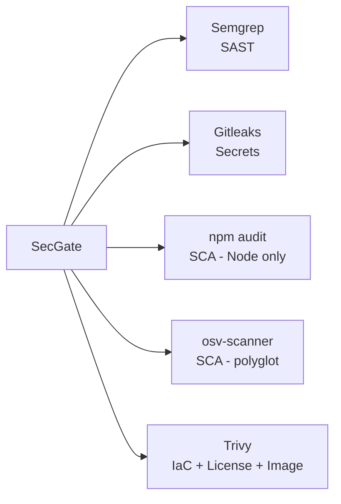

```text
░▒▓█ SECGATE · COVERAGE MATRIX █▓▒░
```

# Scanner Coverage Matrix

Which scanner covers which category — and where the gaps are.

---

## Summary

SecGate orchestrates five scanners spanning five categories. No single scanner covers all categories; the bundle is the product.



---

## Coverage Table

| Category | Scanner | Notes |
|----------|---------|-------|
| **SAST** (static code analysis) | Semgrep | Rule-based. Runs `--config=auto` (rules fetched from the Semgrep Registry for the detected languages), plus `customSemgrepRules` when set. |
| **SCA — Node** (dependency CVE) | npm audit | Runs only when `package.json` is in the target root; needs a lockfile. Uses the npm registry's advisory data. |
| **SCA — polyglot** (multi-ecosystem CVE) | osv-scanner | Reads the lockfiles and manifests osv-scanner supports (npm, PyPI, Go, Cargo, Maven and others). Uses the OSV.dev advisory DB. Overlaps with npm audit for Node — both run. |
| **Secrets** (credentials in git history) | Gitleaks | `gitleaks detect` scans the git history of the repository that contains the target, not uncommitted files. Outside a git repository it is skipped (a coverage gap). Runs with `--redact`. |
| **IaC misconfiguration** | Trivy (`fs` mode) | Trivy's built-in misconfiguration checks (Terraform, CloudFormation, Kubernetes, Dockerfile, Helm and others). |
| **License** | Trivy (`fs` mode) | Detects package licenses with Trivy's license classification and severity. |
| **Container base image** | Trivy (`image` mode) | Discovers `FROM` images in Dockerfiles and scans those base images. Skips `scratch`. First run may download Trivy's vulnerability DB and image metadata. |
| **DAST** (runtime testing) | Not covered — out of scope for a CI gate. |
| **Cloud posture (CSPM)** | Not covered — use cloud-native tools. |

---

## Overlap and Deduplication

Some categories have deliberate overlap for defense in depth:

- **Node dependencies** — both `npm audit` and `osv-scanner` run. They pull from different advisory sources (GitHub Advisories vs OSV.dev). Findings are surfaced separately per scanner in the report; deduplication by CVE ID is planned but not yet implemented.
- **Dockerfile** — Semgrep has Dockerfile rules; Trivy scans Dockerfile for misconfig, and SecGate separately asks Trivy to scan discovered base images. Different lenses (code smell vs policy vs base-image CVEs), all kept.

---

## Explicit Gaps

Honesty matters. These are known limits of the current bundle.

### 1. Built application image layers

SecGate scans base images referenced by Dockerfiles, but it does not build the
application image and scan the resulting final artifact. If your Dockerfile
installs packages during build, those final-layer packages are outside
SecGate's current coverage. Run `trivy image <your-built-tag>` directly for
full image-layer scanning.

### 2. Private SAST rule packs

SecGate runs Semgrep with `--config=auto` only. Semgrep Pro rules are not invoked. Custom rules can be added with `customSemgrepRules` in `.secgate.config.json` (a path inside the target, passed as an extra `--config`). Semgrep-maintained registry rules are under the [Semgrep Rules License v1.0](https://semgrep.dev/legal/rules-license), which limits them to internal use.

### 3. License policy enforcement

Trivy reports licenses with its own severity. SecGate has no allowlist or blocklist, but license findings go through `failOn` like any other finding: a license Trivy rates HIGH or CRITICAL fails the build with the default `failOn`. The curated profile only moves them to the Informational block of the HTML report. To stop license findings from blocking, use `severityOverrides` or `ignore`.

### 4. Binary SCA

No analysis of pre-built binaries (JAR internals, Go binary SBOM extraction). osv-scanner covers lockfiles, not compiled artifacts.

### 5. Git history depth

Gitleaks history scanning depends on the repo being cloned with full history. CI defaults to shallow clones; use `fetch-depth: 0` in `actions/checkout` for full coverage.

### 6. SAST in languages Semgrep lacks rules for

Coverage tracks Semgrep's OSS ruleset. Newer or niche languages may have thin rule coverage.

---

## When SecGate is NOT the right tool

- You need runtime / DAST / production monitoring — use Snyk Runtime, Aikido, or dedicated DAST.
- You need SOC 2 evidence automation — SecGate produces reports but is not a compliance platform.
- You need a managed vulnerability DB with triage workflow — SecGate is a gate, not a ticketing system.
- You need zero-dependency scanning — SecGate requires the upstream scanner binaries to be installed.

---

## Adding a scanner

The bundle is deliberately small (see [ADR-0001](adr/0001-scanner-stack.md)). New scanners must:

1. Cover a category SecGate lacks, or materially improve existing coverage.
2. Be open source and free to use commercially.
3. Output stable JSON for parsing.
4. Not require a cloud account or API key for default operation.

Open an issue with the proposal before opening a PR. The code changes are listed in [`ARCHITECTURE.md`](../ARCHITECTURE.md#adding-a-scanner).

---

See also: [`threat-model.md`](threat-model.md), [`tuning.md`](tuning.md), [`comparison.md`](comparison.md).
