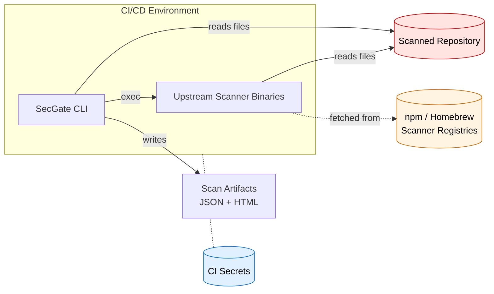
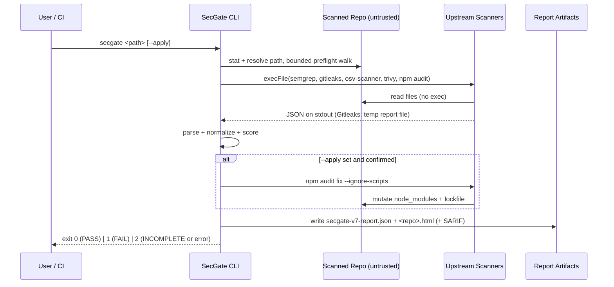

```text
░▒▓█ SECGATE · THREAT MODEL █▓▒░
```

# SecGate Threat Model

STRIDE-based threat model for SecGate.

**Audience:** security reviewers, enterprise adopters, contributors hardening the CLI.

---

## Scope

SecGate is a Node.js CLI that orchestrates upstream scanners (Semgrep, Gitleaks, npm audit, osv-scanner, Trivy) against a target directory, aggregates findings, emits JSON + HTML reports, and optionally runs `npm audit fix`.

This document covers the CLI and its immediate runtime context. It does **not** cover vulnerabilities in upstream scanners themselves (report those upstream).

---

## Trust Boundaries

Four distinct trust zones — each with different adversary assumptions.



| Zone | Trust level | Controlled by |
|------|-------------|---------------|
| SecGate CLI process | Trusted (this repo) | Stelnyx |
| Upstream scanner binaries | Semi-trusted: whatever binary is first on `PATH`; SecGate does not pin or verify versions | Semgrep, Gitleaks project, Google, Aqua, npm |
| Scanned repository contents | **Untrusted** (can be adversarial) | End user / customer / PR author |
| CI environment | Trusted (customer-owned, but holds secrets) | End user |

**Key invariant:** code under the scanned repository path is data, not instructions. SecGate must never execute, `require()`, or `source` anything from the scanned target.

---

## Assets

Ranked by blast radius.

1. **CI secrets** (`GITHUB_TOKEN`, registry tokens, cloud creds) — present in the CI env. Exfiltration is the highest-impact outcome.
2. **Source code in scanned repo** — may contain unpushed IP, unredacted secrets, customer data.
3. **Scan artifacts** (`secgate-v7-report.json`, `<repo>.html`) — contain finding metadata, file paths, rule IDs. Can leak structural info if uploaded publicly.
4. **SecGate process integrity** — compromised output = compromised gate = silent pass on real vulnerabilities.
5. **Host filesystem outside target** — path traversal could read arbitrary files.

---

## Threat Actors

| Actor | Capability | Likelihood |
|-------|-----------|-----------|
| **Malicious scanned repo** — attacker submits PR with hostile code / lifecycle scripts / crafted filenames | Arbitrary file contents, arbitrary `package.json` scripts, symlinks | **High** — primary attack surface for any hosted CI scanner |
| **Compromised scanner binary** — upstream registry hijack, supply-chain attack on Semgrep/Trivy/etc. | Code exec at SecGate's privilege level | Low-Medium — historical precedent exists |
| **Malicious CI workflow** — attacker with write access to `.github/workflows/` invokes SecGate with hostile flags | Full CI env access already; SecGate is not the primary control | Medium — out of scope (customer-owned). `--ignore-target-policy` and `--require` are workflow flags, so an attacker who can edit the workflow can drop them |
| **Malicious config in the scanned repo** — hostile `.secgate.config.json` | Turn scanners off, lower severities, ignore or exclude findings, point `customSemgrepRules` at rules inside the repo | **High** for pull-request CI — mitigated by `--require` and `--ignore-target-policy` (see Tampering). The file is parsed with `JSON.parse` and never executed; `baselineFile` and `customSemgrepRules` must resolve inside the target |

---

## STRIDE Analysis

### S — Spoofing

| Threat | Mitigation |
|--------|-----------|
| Attacker substitutes a fake scanner binary on `$PATH` | SecGate runs the first matching binary on `PATH` and does not verify it. Install scanners from a controlled source (this repo's CI uses `.github/actions/install-scanners`, which pins versions). The composite action runs `npx @stelnyx/secgate@latest` unless `secgate-path` is set, so the CLI version is not pinned either |
| Forged HTML report uploaded as "SecGate output" | Reports are advisory, not authoritative. Real CI gate is exit code from SecGate process run on fresh artifacts |

### T — Tampering

| Threat | Mitigation |
|--------|-----------|
| Scanned repo includes `package.json` with malicious `preinstall`/`postinstall` | Dry-run (default) runs only `npm audit --json`, which does not run lifecycle scripts. `--apply` runs `npm audit fix --ignore-scripts` with `npm_config_ignore_scripts=true`. SecGate never runs `npm install` |
| Symlink in scanned repo points outside target to exfil creds | SecGate's own preflight walk skips symlinks and tracks real directories to avoid cycles. Scanner binaries inherit their own symlink policies. Document: run in container with bind-mount read-only |
| Attacker modifies `secgate-v7-report.json` between runs | Filename is predictable; CI artifact upload uses run-scoped storage. Do not trust reports from across runs |
| Scanner binary tampered in-place | Not detected by SecGate; rely on package-manager integrity and a controlled install step |
| Scanned repo turns scanners off through its own `.secgate.config.json` (`scanners.<name>: false`, or its own `requireScanners`) and still gets PASS | Config is read from the untrusted target, so only the `--require` flag (action input `require`) set in the workflow is trusted: a required scanner that the config disables exits 2. The console prints a NOTE and the JSON report lists `disabledByConfig`; SARIF runs carry `properties.disabledByConfig`. Use `--require` for pull requests. `--require` guarantees that the scanners ran, not that their findings block: without `--ignore-target-policy` the config's `failOn`, `ignore`, `excludePaths` and `severityOverrides` can still hide findings. With `--ignore-target-policy` (action input `ignore-target-policy`) SecGate ignores those four keys and uses the built-in defaults; the console NOTE, the JSON `ignoredTargetPolicy` and SARIF `properties.ignoredTargetPolicy` list the keys the repo had set. The control holds only while pull requests cannot change the workflow file (a `pull_request` run uses the workflow file from the merge commit). Inline `secgate:ignore` comments and the `--baseline` file still come from the scanned repo and can hide a finding even with the flag (#92) |

### R — Repudiation

| Threat | Mitigation |
|--------|-----------|
| Developer claims SecGate "passed" on a release that shipped vuln | The JSON report records version, mode, timestamp, scanner status and coverage. Findings are sorted deterministically; scanner versions and databases are not pinned, so a rerun can differ |
| No audit trail for `--apply` runs | `auditLog[]` in the report (mirrored to stderr) records `apply_confirmed`, `apply_start`, `apply_exec`, `apply_ok` and `apply_fail`; `remediation.executed[]` lists executed fixes. Require code review of `--apply` diffs before merge |

### I — Information Disclosure

| Threat | Mitigation |
|--------|-----------|
| Report uploaded publicly leaks internal file paths | `--strip-paths` (on when `CI=true`) replaces the absolute target path with the repo name |
| Gitleaks output echoes live secrets to stdout/logs | SecGate runs Gitleaks with `--redact`, writes its report to a private temp directory that is deleted afterwards, and keeps only rule ID, description, file and line. No secret value reaches the JSON, HTML or SARIF report |
| CI logs expose SecGate verbose output containing rule context | `--debug` is opt-in only. Default output is summary-level |
| HTML report opened in a browser contacts a third party | The report makes no external requests: it is one file with inline CSS and system fonts, so opening it contacts no third party. `test/engine.mjs` checks that the rendered HTML has no remote `<link>`, `<script src>` or `@import` |

### D — Denial of Service

| Threat | Mitigation |
|--------|-----------|
| Scanned repo contains ReDoS-triggering pattern that hangs Semgrep | SecGate wraps scanner invocations with hard process timeouts. A scanner timeout is reported as `error` / inconclusive, never `clean`. Document: CI-level job timeout as belt-and-braces |
| Giant binary blobs inflate scan runtime | SecGate performs a bounded preflight walk, skips common dependency/VCS/build/vendor directories, skips symlinks, caps depth/file count/file size, and fails with a clear message when limits are exceeded |
| Multi-project workspace contains many nested `node_modules` and `.git` directories | SecGate detects workspace-like targets and asks the user to scan a single project or pass `--allow-workspace` intentionally |
| Fork bomb via malicious scanner substitute | Covered by Spoofing mitigations (pinning) |

### E — Elevation of Privilege

| Threat | Mitigation |
|--------|-----------|
| Command injection via crafted filename passed to scanner | SecGate uses `execFile()` / `execFileSync()` with argument arrays, never shell strings. All user-supplied paths are passed as single `argv[]` entries |
| Path traversal in target argument (`secgate ../../etc`) | Target is resolved to absolute path and used as-is; scanner binaries operate within their own path policies. `baselineFile` and `customSemgrepRules` from the config must resolve inside the target. Run SecGate as non-root |
| `--apply` runs `npm audit fix` which executes lifecycle scripts on fix install | `npm audit fix --ignore-scripts`. Dry-run is default (see ADR-0003), and `--apply` also needs `SECGATE_CONFIRM_APPLY=1` or a `y` at a TTY prompt |

---

## Data Flow



---

## Mitigations Summary

Cross-referenced with epic **#29 (hardening epic)**.

| Mitigation | Status | Reference |
|-----------|--------|-----------|
| `--ignore-scripts` on all npm operations | **Shipped** | `lib/intelligence.mjs` |
| `--strip-paths` flag to remove absolute paths from reports | **Shipped** | README |
| Bounded preflight walk with workspace detection | **Shipped** | README / `lib/walk.mjs` |
| Hard scanner subprocess timeouts with explicit timeout classification | **Shipped** | `lib/utils.mjs` / `test/timeout.mjs` |
| SBOM publication alongside releases | **Shipped** (CycloneDX, GitHub Release assets) | `.github/workflows/release.yml` |
| Signed release artifacts + provenance | **Shipped** (cosign keyless, SLSA, npm provenance) | [`SECURITY.md`](../SECURITY.md#supply-chain-trust) |
| Argument-array subprocess execution (no shell) | **Shipped** | `lib/utils.mjs` |
| Dry-run default for remediation | **Shipped** | ADR-0003 |
| Config file is data, never executed (`JSON.parse` only) | **Shipped** | `lib/config.mjs` |
| `--require` / `--ignore-target-policy` against hostile target config | **Shipped** | README "Untrusted pull requests" |
| Inline suppressions and baseline file still controlled by the target | Open | #92 |
| Scanner version pinning guide | Planned | `docs/tuning.md` |

---

## Out of Scope

- Vulnerabilities in Semgrep/Gitleaks/osv-scanner/Trivy/npm themselves — report upstream.
- Customer CI environment misconfiguration.
- End-user remediation decisions (false-positive acceptance is a user responsibility).

---

## Revision history

| Date | Change |
|------|--------|
| 2026-04-23 | Initial publication |
| 2026-11-20 | Aligned with the `v0.3.3` code: execFile, config threat actor, Gitleaks redaction, HTML font request, shipped SBOM and signing |

See also: [`coverage.md`](coverage.md), [`tuning.md`](tuning.md), [`adr/`](adr/), [`../SECURITY.md`](../SECURITY.md).
